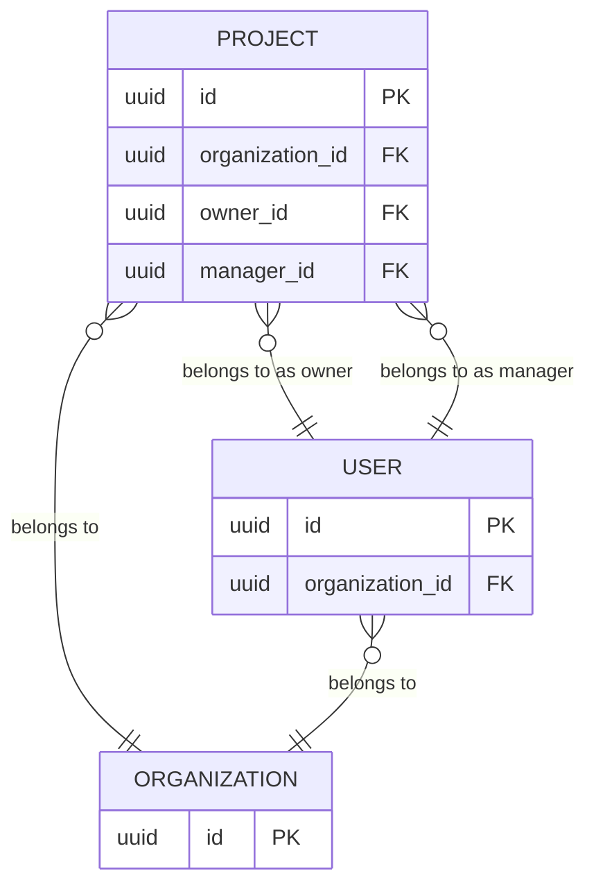

I came to Elixir from Ruby, as did most of my team and many Elixir developers at the time. When we needed test data for Ecto, we were literally looking for FactoryBot for Elixir. ExMachina was presented by FactoryBot's creators as exactly that, so we added it without questioning the choice.

FactoryBot and ExMachina organize test data around models or schemas: define their attributes and associations, then build or persist them. That is what I mean by database factories in this article. The plain helpers in [Ecto's test factories guide](https://hexdocs.pm/ecto/3.14.2/test-factories.html) fit the same model.

The problem is the model itself, which looks good in Hello World examples but forces you to work around it in a real business application.

## Automatic associations build the wrong graph

Suppose a project, its owner, and its manager must all belong to the same organization:



A typical ExMachina implementation looks like this:

```elixir
def organization_factory do
  %MyApp.Organization{name: "Acme"}
end

def user_factory do
  %MyApp.User{
    organization: build(:organization)
  }
end

def project_factory do
  %MyApp.Project{
    organization: build(:organization),
    owner: build(:user),
    manager: build(:user)
  }
end
```

A test then creates a project with one call:

```elixir
project = insert(:project)
```

The result contains one project, two users, and three organizations. The project belongs to one organization, while its owner and manager belong to two others. The records satisfy the database constraints, but the business state is wrong.

To create a valid project, the test has to build the graph explicitly:

```elixir
organization = insert(:organization)
owner = insert(:user, organization: organization)
manager = insert(:user, organization: organization)

project =
  insert(:project,
    organization: organization,
    owner: owner,
    manager: manager
  )
```

That restores correctness, but it also bypasses ExMachina's main feature: creating the association graph automatically and persisting it from one `insert(:project)` call. The persistence part mattered in 2015, when Ecto could not yet insert such a graph itself. After Ecto 2.0 added [support for it](https://github.com/elixir-ecto/ecto/issues/1102), ExMachina [removed most of its Ecto-specific code](https://github.com/beam-community/ex_machina/pull/100) and delegated insertion to `MyApp.Repo.insert!`.

Once associations are inserted and passed explicitly, the factory library is no longer needed. The remaining code fits the small helper pattern from Ecto's documentation:

```elixir
def build(:user, attributes \\ []) do
  %MyApp.User{name: "Jane"}
  |> struct!(attributes)
end

def insert(factory_name, attributes \\ []) do
  factory_name
  |> build(attributes)
  |> MyApp.Repo.insert!()
end
```

These two functions cover the useful core of a database factory. The vast majority of ExMachina's remaining API is unnecessary.

## I tried to make ExMachina reuse associations

Our tests were not as fast as I wanted them to be. When I traced test setup, I found that the automatic association behavior shown above was producing an embarrassing number of unnecessary records. Removing ExMachina from the existing suite was not a small change, so I tried to reduce those inserts without abandoning it. Here is a simplified version using the schema from the example above:

```elixir
def maybe_insert(%{__meta__: %{state: :built}} = value) do
  ExMachina.EctoStrategy.handle_insert(value, %{repo: MyApp.Repo})
end

def maybe_insert(value), do: value

def maybe_get_assoc(nil, _association), do: nil

def maybe_get_assoc(value, association) do
  value
  |> MyApp.Repo.preload(association)
  |> get_in(association |> List.wrap() |> Enum.map(&Access.key!/1))
end

def project_factory(attrs) do
  owner = maybe_insert(attrs[:owner])
  manager = maybe_insert(attrs[:manager])

  organization =
    maybe_insert(attrs[:organization]) ||
      maybe_get_assoc(owner, :organization) ||
      maybe_get_assoc(manager, :organization) ||
      insert(:organization)

  shared_user = owner || manager || insert(:user, organization: organization)

  %MyApp.Project{
    organization: organization,
    owner: owner || shared_user,
    manager: manager || shared_user
  }
end
```

The workaround improved performance in parts of the suite and produced more consistent association graphs, but it remained low-level and incomplete. If both owner and manager arrived as built structs, each could bring its own automatically built organization. Handling that case required more traversal and association replacement. I was already writing a dependency planner inside ExMachina.

## Let the application create the state

A business operation can say more in a few words than a bunch of inserts. With direct inserts, starting a conversation means creating a thread, two participants, the first message, and a read marker for its author:

```elixir
thread = insert(:thread)

insert(:thread_participant, thread: thread, user: author)
insert(:thread_participant, thread: thread, user: recipient)

message =
  insert(:message,
    thread: thread,
    sender: author,
    body: "Hello"
  )

insert(:message_read, message: message, user: author)
```

The `message_read` record is easy to omit because it looks optional, or simply because the author forgets it. Enough small omissions like this, and tests begin from states the application itself never creates.

The test can instead call the application operation that already creates a valid conversation:

```elixir
%{thread: thread, message: message} =
  MyApp.Chat.start_conversation!(author, recipient, %{body: "Hello"})
```

The application operation already knows how to assemble this state. If the persistence model changes but starting a conversation does not, tests that call the operation do not have to change with it.

Calling business functions can make test setup slower than direct inserts, but a fast test that starts from the wrong state is not useful. Saša Jurić [reported](https://x.com/sasajuric/status/1274039588273762310) that after banning ExMachina from new client projects and using context functions instead, their tests became simpler and more reliable.

## One interface for business operations

In another codebase, I did not add ExMachina. I wrote a `params_for` helper that took an operation name and optional overrides:

```elixir
def params_for(:create_project, overrides \\ %{}) do
  %{
    name: random_string(),
    description: random_string()
  }
  |> Map.merge(overrides)
end
```

A test used it like this:

```elixir
create_project_params = params_for(:create_project)

project =
  MyApp.Projects.create_project!(
    create_project_params,
    %{
      organization: organization,
      owner: user,
      manager: user
    }
  )
```

`params_for` could generate inputs for an operation that created several entities, but it could not create or pass that operation's dependencies.

The helper was global, so `:create_project` had to be unique across the application. The name already identified the operation, but every test still had to pair it with `MyApp.Projects.create_project!/2`. My next prototype put that pairing in one map:

```elixir
%{
  create_organization: %{...},
  create_user: %{...},
  create_project: %{
    params: %{
      organization: fn -> raise "specify manually" end,
      owner: fn -> raise "specify manually" end,
      manager: fn -> raise "specify manually" end,
      name: &random_string/0,
      description: &random_string/0
    },
    resolve: fn args ->
      project =
        MyApp.Projects.create_project!(
          Map.take(args, [:name, :description]),
          Map.take(args, [:organization, :owner, :manager])
        )

      %{project: project}
    end
  }
}
```

Nothing in this registry depends on Ecto. A resolver can write to any storage system or avoid persistence entirely.

I added `exec/2` to look up the operation, generate missing parameters, merge explicit values, and call its resolver with one map. Tests now had one interface while the application function kept its original API:

```elixir
%{project: project} =
  exec(:create_project,
    organization: organization,
    owner: user,
    manager: user
  )
```

This version of `exec` returned the resolver's result directly and removed the separate `params_for` call, but callers still had to supply associations. ExUnit setup already provided a shared map for them: each callback receives the context and returns values merged back into it. I changed `exec` to read matching parameters from that context and return the updated map:

```elixir
context = %{
  organization: organization,
  owner: user,
  manager: user
}

%{project: project} = exec(context, :create_project)
```

The context-aware `exec` merges the resolver's result into the context and returns the updated map, so commands can be piped together:

```elixir
%{organization: organization, user: user, project: project} =
  %{}
  |> exec(:create_organization)
  |> exec(:create_user)
  |> then(fn context ->
    Map.merge(context, %{owner: context.user, manager: context.user})
  end)
  |> exec(:create_project)
```

This worked, but every test still repeated the dependency order and the manual mapping from `user` to `owner` and `manager`.

## From commands to entities

The registry still did not record that one command's output could satisfy another command's input. I solved that by assigning an entity name to each value stored in the context.

An entity name identifies a role in the test context, not a database type. A client owner and an internal manager can therefore be separate entities even when both are stored in the same `users` table. In the simpler schema below, both roles deliberately refer to `:user`, so one record fills both roles.

To describe and validate the entities produced and required by each command, I replaced the map registry with a DSL built with [Spark](https://github.com/ash-project/spark) and added a dependency-resolution engine.

That implementation became SeedFactory ([GitHub](https://github.com/fuelen/seed_factory), [documentation](https://hexdocs.pm/seed_factory)). Here is the same registry as a SeedFactory schema:

```elixir
defmodule MyApp.SeedFactorySchema do
  use SeedFactory.Schema

  command :create_organization do
    param :name, generate: &Faker.Company.name/0

    resolve(fn args ->
      with {:ok, organization} <- MyApp.Organizations.create(args) do
        {:ok, %{organization: organization}}
      end
    end)

    produce :organization
  end

  command :create_user do
    param :name, generate: &Faker.Person.name/0
    param :plan, value: :free
    param :organization, entity: :organization

    resolve(fn args ->
      with {:ok, user} <-
             MyApp.Users.create(args.organization, Map.take(args, [:name, :plan])) do
        {:ok, %{user: user}}
      end
    end)

    produce :user
  end

  command :create_project do
    param :organization, entity: :organization
    param :owner, entity: :user
    param :manager, entity: :user
    param :name, generate: &Faker.Company.catch_phrase/0
    param :description, generate: &Faker.Lorem.paragraph/0

    resolve(fn args ->
      project =
        MyApp.Projects.create_project!(
          Map.take(args, [:name, :description]),
          Map.take(args, [:organization, :owner, :manager])
        )

      {:ok, %{project: project}}
    end)

    produce :project
  end
end
```

With no entities in the context, `exec(context, :create_project)` creates the missing dependencies and returns the context with execution metadata. The output below shows only the execution history:

```elixir
context = exec(context, :create_project)

%{organization: organization, user: user, project: project} = context

IO.inspect(context.__seed_factory_meta__.execution_history)
```

```text
[#execution[exec(create_project): create_organization → create_user → create_project]]
```

Both `owner` and `manager` refer to the `:user` entity, so SeedFactory uses the same user for both roles. An organization or user already present in the context is reused.

Dependencies can still be passed explicitly:

```elixir
%{project: project} =
  exec(context, :create_project,
    organization: organization,
    owner: owner,
    manager: manager
  )
```

`exec/2` starts from a particular command. With `produce/2`, the test only names the entity it needs:

```elixir
context = produce(context, :project)
```

When the schema also contains an independent `:announcement` branch, a test can request both:

```elixir
context = produce(context, [:project, :announcement])
```

This brings the API back to a short declaration of the test data, much like `insert(:project)`. SeedFactory resolves the required command branches, stores their results in the context, and reuses matching entities already there.

## Traits describe state

[FactoryBot traits](https://thoughtbot.github.io/factory_bot/traits/summary.html) are named groups of attributes, and they can also be applied to associations. ExMachina has no trait API. Its [README](https://github.com/beam-community/ex_machina#flexible-factories-with-pipes) uses derived factories and pipe helpers for similar variations. SeedFactory keeps the idea of a named variation but maps it to a command execution, so a trait can point to a command alone, require fixed arguments, or accept a value:

```elixir
command :activate_user do
  param :user, entity: :user, with_traits: [:pending]

  resolve(fn %{user: user} ->
    {:ok, %{user: MyApp.Users.activate!(user)}}
  end)

  update :user
end

command :set_user_country do
  param :user, entity: :user
  param :country

  resolve(fn %{user: user, country: country} ->
    {:ok, %{user: MyApp.Users.set_country!(user, country)}}
  end)

  update :user
end

# A trait assigned by the creation command
trait :pending, :user do
  exec :create_user
end

# A transition from :pending to :active
trait :active, :user do
  from :pending
  exec :activate_user
end

# Match fixed command arguments
trait :free, :user do
  exec :create_user, args_pattern: %{plan: :free}
end

trait :premium, :user do
  exec :create_user, args_pattern: %{plan: :premium}
end

# Accept the value supplied through produce/2
trait :country, :user do
  exec :set_user_country, args_pattern: %{country: _}
end
```

Country is a parameterized trait, so its value becomes part of the entity's recorded state. Requesting the same value does nothing, while another value runs `set_user_country` again.

Traits are requested declaratively through `produce`:

```elixir
# Trait with fixed command arguments
context = produce(context, user: [:premium])

# Transition and parameterized trait
context = produce(context, user: [:active, country: "Germany"])

# New value for the parameterized trait
context = produce(context, user: [country: "Canada"])

IO.inspect(context.__seed_factory_meta__)
```

```text
#SeedFactory.Meta<
  current_traits: %{
    user: [:premium, :active, {:country, "Canada"}],
    organization: []
  },
  execution_history: [
    #execution[produce(user: [country: "Canada"]): set_user_country],
    #execution[produce(user: [:active, {:country, "Germany"}]): activate_user → set_user_country],
    #execution[produce(user: [:premium]): create_organization → create_user]
  ],
  ...
>
```

If a required state cannot be recreated through the application's business operations, as with some legacy or intentionally invalid states, a test can still use direct `MyApp.Repo` calls or a private helper. If the same shortcut is repeated in several tests, it can become a command in the SeedFactory schema, keeping shared setup paths in one central registry.

A natural question at this point is what happens when a test needs two users, since both would be stored under the same `:user` name. SeedFactory has [a mechanism for that](https://hexdocs.pm/seed_factory/SeedFactory.html#module-rebinding), and a few more features I have not covered, but I had to stop somewhere before this article turned into a retelling of the documentation. I wanted to show the reasoning that led to this API.

## Final thought

The database-factory model, where tests request records and factories create their associations, is the `goto` statement of test setup. You can live with it, but it makes the test suite harder to maintain.
